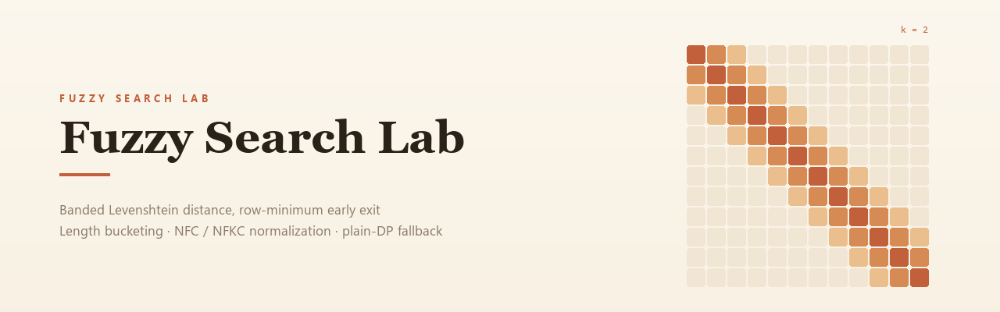

<p align="center">
  
</p>

# Fuzzy Search Lab

一个零依赖的 Python 模糊搜索索引：阈值编辑距离 + 长度分桶 + Unicode 规范化，
用于拼写错误、多语言名称和中小规模词库的近似匹配。

**先保证结果一致，再谈加速。** 每个优化都有差分测试兜底：优化实现与朴素实现逐条比对，
基准脚本一旦发现完整命中列表不一致就直接失败。无运行时第三方依赖，Python 3.10+。

## 项目亮点

- **阈值编辑距离**：长度差剪枝、带状动态规划、行最小值提前退出；带宽覆盖整个矩阵时自动退回普通 DP。
- **多语言文本处理**：NFC + `casefold()`；可选 `compatibility=True` 走 NFKC，折叠全角/半角与兼容字符。
- **查询索引复用**：建索引时规范化并缓存，按规范化后的字符串长度分桶。
- **稳定排序**：先按编辑距离，再按原始输入顺序，结果可复现。
- **随机差分测试**：2500 组随机串 × 5 个阈值，逐条对齐朴素实现。
- **可复现基准**：`benchmark.py`（单语料）与 `shape_matrix.py`（四种语料形态）。

## 快速开始

需要 Python 3.10 或更新版本。

```bash
python examples/demo.py
python -m unittest discover -s tests -v
python benchmarks/benchmark.py
python benchmarks/shape_matrix.py
```

从源码导入：

```python
from fuzzyopt import FuzzySearchIndex

index = FuzzySearchIndex([
    "无线蓝牙耳机",
    "机械键盘",
    "Tokyo Travel Guide",
    "Café Latte Mug",
])

for match in index.search("无现蓝牙耳机", max_distance=2):
    print(match.value, match.distance, match.similarity)
```

若从仓库根目录以外调用，先安装开发版本：

```bash
python -m pip install -e .
```

### 全角输入

默认只做 NFC，`ＡＢＣ` 与 `ABC` 被视为不同字符串。中文输入法切全角、日文半角假名是日常操作，
需要时打开兼容折叠：

```python
wide = FuzzySearchIndex(["ABC", "カタカナ"], compatibility=True)
wide.search("ＡＢＣ", max_distance=0)      # -> ABC
wide.search("ｶﾀｶﾅ", max_distance=0)       # -> カタカナ
```

NFKC 同时会把 `①` 折成 `1`、`㈱` 折成 `(株)`、`fi` 折成 `fi`，所以它是可选项而不是默认值。

## 算法做了什么

| 部分 | 基线 | 本索引 | 什么时候有效 |
|---|---|---|---|
| 候选筛选 | 逐个计算完整距离 | 只扫长度在 `[len-k, len+k]` 的桶 | 语料长度分散时；长度集中在 ±k 内等于全表扫描 |
| 编辑距离 | 完整 DP 矩阵 | 只算阈值允许的对角带 | 带宽明显小于矩阵时；短串 + 大 k 自动退回普通 DP |
| 提前退出 | 无 | 整行最小值超过阈值时终止 | 无关候选占多数时 |
| 文本预处理 | 每次查询重新规范化 | 建索引时规范化并缓存 | 索引被复用多次时 |
| 结果收集 | 全量排序 | `limit` 用有界堆，只物化入选条目 | 命中很多而只需要前几条时 |

完整的复杂度边界和已知限制见 [`docs/algorithm.md`](docs/algorithm.md)。

## 性能：取决于语料形态，不是固定倍数

本机实测（CPython 3.13.14 / Windows 11 x64，12,000 条语料 × 6 条查询，`k=2`）。
两种实现交错取样、取中位数，抵消 CPU 降频；基线是「预先规范化 + 普通 DP + 相同结果对象」，
不是偷懒的写法：

| 语料形态 | 长度种类 | 分桶后仍需扫描 | 基线 | 本索引 | 加速 |
|---|---|---|---|---|---|
| 英文商品名（22–55 字符） | 34 | 29.1% | 6,602 ms | 59.2 ms | **112×** |
| 中文商品名（10–16 字） | 7 | 72.7% | 980 ms | 138.1 ms | **7.1×** |
| 日文书名（14–17 字） | 4 | 97.9% | 1,263 ms | 182.3 ms | **6.9×** |
| 2–3 字中文人名 | 2 | 100% | 204.9 ms | 202.5 ms | **1.01×** |

读法很简单：**分桶能筛掉多少，决定了加速比的上限。**

- 英文商品名长短差 33 个字符，`k=2` 只能筛掉 71% 的候选，加速比冲到三位数；
- 中文商品名 7 种长度，还能筛掉四分之一，7.1×；
- 2–3 个字的人名只有两种长度，分桶一条都筛不掉，于是退回基线水平（1.01×）—— 不会更慢，
  但也不该期待倍数。

`benchmarks/benchmark.py` 用的是长度分散的合成语料（24 种长度、6–30 字符），所以数字好看，
它不是所有场景的承诺。`benchmarks/shape_matrix.py` 给出四种形态的对照，每行都带
「分桶后仍需扫描」的比例，可以对着自己的数据估上限。

## 目录结构

```text
src/fuzzyopt/          核心算法与索引
tests/                 正确性与随机差分测试
benchmarks/            单语料基准 + 四种语料形态对照
examples/              可直接运行的示例
docs/                  算法说明
UPSTREAM_NOTES.md      上游项目与源码来源说明
```

## 可继续做的优化

长度分桶只能利用「长度」，碰到长度高度集中的语料就失效。要再上一个量级，需要按内容剪枝：

1. SymSpell 删除词索引，把候选量从 O(n) 降到与编辑距离相关。
2. n-gram 倒排索引，并配套召回率评估。
3. 可选的拼音/罗马字转写层（作为插件，不默认改变语义）。
4. 真实数据集基准与内存测量。
5. 用 Hypothesis 或 coverage-guided fuzzing 扩展随机验证。

## 上游研究入口

- [uFuzzy](https://github.com/leeoniya/uFuzzy) — MIT
- [Fuse.js](https://github.com/krisk/Fuse) — Apache-2.0
- [RapidFuzz](https://github.com/rapidfuzz/RapidFuzz) — MIT

**来源说明：** 本项目是独立编写的优化实验，不是以上任一项目的 fork，也没有复制其源码。
细节见 [`UPSTREAM_NOTES.md`](UPSTREAM_NOTES.md)。

## License

MIT。见 [`LICENSE`](LICENSE)。
